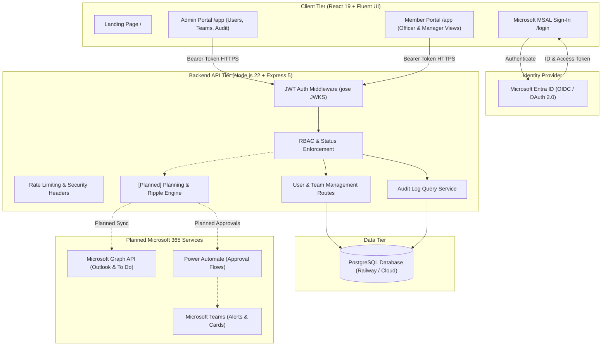
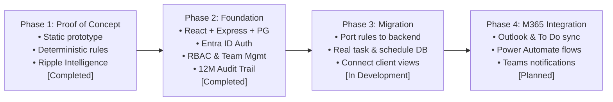

# SyncAI — Smart Work Planner

**Know what matters. Understand what changes. Choose the safer plan.**

SyncAI is an AI-enabled **Smart Work Planner** developed for Town Council Property Officers and their supervisory managers. Built by **IT2134 Team 24** for the **EM Services (EMS) Challenge PS 12i — Smart Work Planner (Microsoft-based)** (NYP School of IT × SCCCI × EM Services Techno Semester, October–November 2026).

---

## The Operational Problem

Town Council Property Officers operate in high-density residential estates, managing 2,500 to 2,700 housing units each. In their daily operations, officers face heavy, competing demands:

- **Genuine public safety hazards:** Lift faults, concrete spalling, exposed electrical wiring, and chute fire risks that demand immediate physical response.
- **Strict statutory and compliance deadlines:** Periodic inspections, lift certifications (BCA), fire safety compliance (SCDF), and Town Council co-funding claim cut-offs that cannot slip without legal exposure.
- **Real service impact vs. loudest-voice bias:** Demanding residents frequently escalate complaints; however, complaint frequency alone does not indicate genuine risk or urgency.
- **Long-term consequences of deferral:** Unaddressed minor defects (such as ceiling seepage) can rapidly penetrate structural rebar, resulting in concrete spalling and major emergency repair expenditures.
- **Time and capacity bottlenecks:** Officers spend substantial portions of their day on resident communication, contractor inspections, and administrative invoice verification, leaving tight margins when emergencies arise.

**SyncAI does not replace the Operations Command Centre (OCC).** The OCC provides situational oversight of where officers are and what events are active. SyncAI complements this by providing forward-looking operational planning and impact intelligence: helping officers and managers structure achievable days and understand the ripple effect before schedules change.

---

## Latest EM Services Client Feedback & Requirements (November 2026)

Following our latest consultation with EM Services (EMS), the prototype and system architecture have been enhanced around five core operational realities:

1. **Operations Command Centre (OCC) Complementarity:**
   - EMS noted potential future connectivity with its Operations Command Centre.
   - SyncAI does **not** claim live OCC integration or duplicate the PS 12g Operations Hub.
   - The prototype includes clearly labelled fictional mock records (`OCC (Mock)`) to demonstrate how OCC-originated tasks (e.g. lift entrapments or building fault telemetries) seamlessly flow into an officer's daily schedule.
2. **Client Case Prioritisation Order vs. Operational Model:**
   - EMS stated the client assessment priority: **1. Service → 2. Safety → 3. Residents' well-being → 4. Actual concern / urgency**.
   - SyncAI incorporates this four-tier breakdown into task details and explainability views, while maintaining strict adherence to statutory, safety, and operational boundaries:
     - Routine service requests **never** blindly outrank imminent physical danger (e.g. lift faults or falling concrete).
     - Statutory and regulatory compliance deadlines (BCA/SCDF) act as non-negotiable hard constraints.
     - Repeat complaint volume alone continues to award **0 points**, preventing loudest-voice bias.
     - Clear disclaimers in the UI specify that numerical scoring weights are Team 24's proposed operational model awaiting formal empirical calibration with EMS.
3. **SLA-Aware Scheduling & Fixed Resident Appointments:**
   - Property Officers manage strict Service Level Agreement (SLA) cut-offs, fixed repair appointment windows, and compliance obligations.
   - The prototype evaluates SLA due times (`slaDue`), flags tight buffer windows (<60m), raises high-risk warnings for breached SLAs, and protects fixed resident appointments during disruption rescheduling.
4. **Hierarchical Management Approval Workflow:**
   - Schedule adjustments and cross-officer reassignments follow an authorised management hierarchy:
     $$\text{Team Member proposes change} \longrightarrow \text{Assigned Manager reviews} \longrightarrow \text{Optional escalation} \longrightarrow \text{Audit trail recorded} \longrightarrow \text{Applied to plan}$$
   - **Self-approval prevention:** Property Officers cannot approve their own restricted schedule change requests.
   - All approval decisions, rejections, and escalations generate immutable audit records.
5. **Auditable Simulated Communications (In-App, Teams, WhatsApp):**
   - EMS relies heavily on WhatsApp alongside Microsoft 365.
   - SyncAI models simulated notification adapters across **In-App**, **Microsoft Teams (proposed)**, and **WhatsApp (proposed)**.
   - **Strict Privacy & Architecture Safeguards:** No real WhatsApp Business API or Meta credentials are used. Notification previews contain zero sensitive resident data and provide secure in-app verification links (`syncai://approval/...`) directing users back into SyncAI where decisions are authenticated and audited.

---

## Flagship USP & Signature Differentiator

### Flagship USP: Operationally Aware AI Scheduling

Unlike generic productivity apps that sort tasks merely by due date or complaint volume, SyncAI plans work around operational reality across three core capabilities:

1. **Consequence-Aware Prioritisation:** Ranks tasks by evaluating genuine safety hazards (+20 pts), mandatory statutory compliance (+25 / +15 pts), service impact (+8 pts), and long-term consequences of delay (+12 pts). Repeat complaints award **0 priority points**—keeping volume visible without distorting operational focus.
2. **Capacity-Aware Scheduling:** Validates task duration estimates against an officer's actual working hours, Outlook meetings, lunch breaks, and travel buffers, proactively flagging mathematically impossible conflicts.
3. **Operational Ripple Intelligence (Signature Proposed Differentiator):** Evaluates how disruptions, delays, or reassignments propagate across multi-level task dependencies, officer capacity, and statutory deadlines before any changes are committed.

```
┌─────────────────────────────────────────────────────────────────────────┐
│                      OPERATIONAL RIPPLE INTELLIGENCE                    │
├───────────────────┬─────────────────────────┬───────────────────────────┤
│ 1. Disruption     │ 2. Cascade Evaluation   │ 3. Three Alternatives     │
│    Trigger        │    & Dependencies       │    Side-by-Side           │
├───────────────────┼─────────────────────────┼───────────────────────────┤
│ • Urgent safety   │ • Multi-level traversal │ • Alternative A:          │
│   incident (lift) │   (t103 → t104 → t112)  │   No Action               │
│ • Officer medical │ • Capacity deficits     │ • Alternative B:          │
│   leave (MC)      │ • Protected statutory   │   Reschedule Lower-Impact │
│ • Extra compliance│   deadlines (BCA/SCDF)  │ • Alternative C:          │
│   assignment      │ • Potential defect risk │   Reassign Eligible Work  │
└───────────────────┴─────────────────────────┴───────────────────────────┘
```

### Three-Alternative Scenario Comparison

When an operational disruption occurs, SyncAI evaluates three distinct operational paths:

- **Alternative A: No Action (Baseline):** Demonstrates the operational exposure of doing nothing—highlighting unmitigated deadline slips, breached compliance dates, and customer friction.
- **Alternative B: Reschedule Lower-Impact Work:** Retains work with the assigned officer by deferring routine admin or non-critical inspections to protect mandatory compliance deadlines.
- **Alternative C: Reassign Eligible Work:** Identifies alternative officers with spare capacity and enforces domain certifications (e.g. lift specialist), flagging unqualified officers even if they have available hours.

> **Human-in-the-Loop Decision Support:** AI generates explainable recommendations, but estate managers and property officers review and approve every schedule adjustment before it takes effect.

---

## Current Implementation Status

SyncAI maintains a strict separation between its interactive proof-of-concept prototype and the production full-stack application:

| Capability / Tier | Static Prototype (`prototype/`) | Full-Stack Application (`client/` & `server/`) | Planned / Roadmap |
| --- | --- | --- | --- |
| **User Interface** | HTML5, CSS3, vanilla JavaScript ES modules (Fluent 2 inspired) | React 19, Vite, Microsoft Fluent UI components | Continuous UX refinement |
| **Authentication** | Simulated role switching (`localStorage` session) | **Implemented:** Microsoft Entra ID (MSAL) with JWT signature validation | Multi-tenant policy configuration |
| **Data Persistence** | Browser `localStorage` seeded with fictional data | **Implemented:** PostgreSQL with parameterized queries and migrations | Entity tables for tasks and schedules |
| **Access Control & Approvals** | **Implemented:** Hierarchical manager approval workflow & self-approval prevention | **Implemented:** Admin approval queue, role enforcement (`admin`, `manager`, `member`) | Granular zone/estate permissions |
| **Team Management** | Hard-coded officer zones and skills | **Implemented:** Admin team management, manager assignment, member placement | Dynamic multi-team assignment |
| **Audit Logging** | In-memory activity log & approval decision audits | **Implemented:** 12-month append-only audit trail in PostgreSQL | Export to external compliance log |
| **Priority Scoring** | **Implemented:** Deterministic scoring engine (`ai.js`, 0–100 score, EMS 4-tier criteria breakdown) | Placeholder page in Member Portal | Migration to Express API planning service |
| **Schedule Feasibility** | **Implemented:** Time-blocking against meetings, buffer, SLAs, and appointments (`planner.js`) | Placeholder page in Member Portal | Migration to Express API planning service |
| **Ripple Intelligence** | **Implemented:** Multi-level dependency analysis, SLA risk, and 3 alternatives (`ripple.js`) | Conceptual preview in How SyncAI Decides | Migration to Express API planning service |
| **M365 & Notifications** | Mock Outlook meetings and multi-channel simulated alerts (In-App, Teams, WhatsApp) | Not connected | Microsoft Graph (Outlook, To Do), Power Automate, Teams |
| **OCC Complementarity** | Fictional mock records labelled `OCC (Mock)` | Not connected | Real-time event ingestion adapter |
| **Language Features** | Deterministic keyword and regex extraction | Help-guide Q&A preview (4 languages) | Optional Azure OpenAI assistance |

*Note: The prototype's intelligence is deterministic and rules-based. It is not an unverified black-box predictive ML model, ensuring all scheduling advice is explainable and auditable.*

---

## System Architecture



See [docs/architecture.md](docs/architecture.md) for full architectural specifications, security controls, and data schemas.

---

## Role-Based Access Control

SyncAI supports three distinct application roles:

| Application Role | Operational Persona | Key Capabilities |
| --- | --- | --- |
| **System Administrator** (`admin`) | Technical Administrator | Approves new accounts, assigns roles, manages team memberships, monitors 12-month audit activity log. Has no access to operational tasks or schedule boards. |
| **Manager** (`manager`) | Supervisory Manager / Estate Manager | Oversees assigned team members, reviews team capacity, evaluates What-If disruption simulations, approves reassignments, and manages statutory compliance risks. |
| **Team Member** (`member`) | Property Officer / Front-Line Staff | Manages personal daily schedules, views recommended task priorities with explainable score breakdowns, performs site inspections, and requests emergency schedule adjustments. |

---

## Repository Structure

```text
SyncAI/
├── client/                 # Full-stack React 19 + Vite frontend (Fluent UI, MSAL)
│   ├── src/                # Portals, components, i18n translations, MSAL config
│   └── README.md           # Client setup, environment variables, and architecture
├── server/                 # Full-stack Node.js 22 + Express 5 backend API
│   ├── src/                # Auth middleware, RBAC rules, PostgreSQL models
│   └── README.md           # Server setup, database migrations, and security
├── prototype/              # Interactive proof-of-concept prototype (vanilla JS)
│   ├── js/                 # ai.js, planner.js, simulation.js, ripple.js
│   ├── site/               # Prototype marketing website and demo sign-in
│   ├── tests/              # Automated tests for rules and ripple engines
│   └── README.md           # Prototype user guide and scenario walkthroughs
├── docs/                   # Engineering and client documentation
│   ├── architecture.md     # System architecture, security model, and EMS requirements
│   └── demo-script.md      # 7-minute presentation walkthrough of Ripple Intelligence
├── CONTRIBUTING.md         # Contribution standards, branch conventions, review checklist
├── SECURITY.md             # Vulnerability disclosure, PDPA compliance, secret handling
└── CODE_OF_CONDUCT.md      # Community standards (Contributor Covenant v2.1)
```

---

## Getting Started

### 1. Interactive Static Prototype

The prototype requires no build steps or external dependencies (Python 3 standard library only):

```bash
# Start local prototype web server
python prototype/serve.py
```

- **Website:** <http://localhost:8765/site/>
- **Sign-In:** <http://localhost:8765/site/login.html> (Demo accounts provided on page)
- **Portal:** <http://localhost:8765/>

Run the automated prototype test suite (Node.js 20+ built-in test runner):

```bash
node --test "prototype/tests/*.test.mjs"
# Verified: 56 automated tests pass (rules, ripple, client requirements, and status codes)
```

### 2. Full-Stack Application

Requires **Node.js 22 or later** and an accessible PostgreSQL instance.

#### Backend Setup (`server/`)

```bash
cd server
npm install
cp .env.example .env
# Configure DATABASE_URL and ENTRA_CLIENT_ID in server/.env
npm run dev
# Starts Express API at http://localhost:3000/api
```

Run backend unit and security tests:

```bash
npm test
# Verified: 21 automated tests pass (auth, RBAC, teams, audit)
```

#### Frontend Setup (`client/`)

```bash
cd client
npm install
cp .env.example .env
# Configure VITE_ENTRA_CLIENT_ID and VITE_ENTRA_TENANT_ID in client/.env
npm run dev
# Starts Vite dev server at http://localhost:5173
```

Run frontend component and logic tests:

```bash
npm test
# Verified: 16 automated tests pass (help guide, i18n, time, http status)
```

---

## Demonstration Links

- **Main Repository:** <https://github.com/feliciatanxl/SyncAI>
- **Static Prototype (GitHub Pages):** <https://feliciatanxl.github.io/SyncAI/site/index.html>

*(Note: Live deployment links to cloud-hosted Railway containers remain internal for development and are subject to Azure tenant registration.)*

---

## Scope Boundary & Problem Statement Alignment

SyncAI is specifically engineered for **EM Services Challenge PS 12i — Smart Work Planner (Microsoft-based)**.

- **In Scope (PS 12i):** Property Officer task scheduling, explainable priority scoring, capacity-aware planning, What-If disruption simulations, and Operational Ripple Intelligence.
- **Out of Scope:**
  - PS 12g Operations Hub (resident multi-channel complaint intake and case consolidation).
  - PS 12h Project Tracker (management-level capital project Gantt tracking and contractor procurement).
  - Payroll, HR records, medical diagnoses (absences record only general categories such as MC or leave).
  - Production write access to live Town Council Enterprise systems without explicit EMS authorization.

*(Note: Historical prototype exploratory pages `hub.js`, `sources.js`, and `projects.js` have been retired from primary navigation to maintain strict PS 12i focus while preserving foreign-key data integrity.)*

---

## Development Roadmap



---

## Documentation Navigation

- [System Architecture](docs/architecture.md) — Detailed technical specifications, data models, and security boundaries.
- [Presentation Demo Script](docs/demo-script.md) — A 7-minute structured walkthrough of Operational Ripple Intelligence.
- [Prototype Guide](prototype/README.md) — Developer documentation, rules logic, and scenario references.
- [Client Frontend Guide](client/README.md) — React architecture, MSAL integration, and component library.
- [Server Backend Guide](server/README.md) — Express API routes, PostgreSQL schema, and security controls.
- [Contributing Guidelines](CONTRIBUTING.md) — Git workflow, coding standards, and review checklists.
- [Security Policy](SECURITY.md) — Responsible disclosure, secret management, and PDPA safeguards.
- [Code of Conduct](CODE_OF_CONDUCT.md) — Community standards and professional expectations.
- [License](LICENSE) — MIT License.
