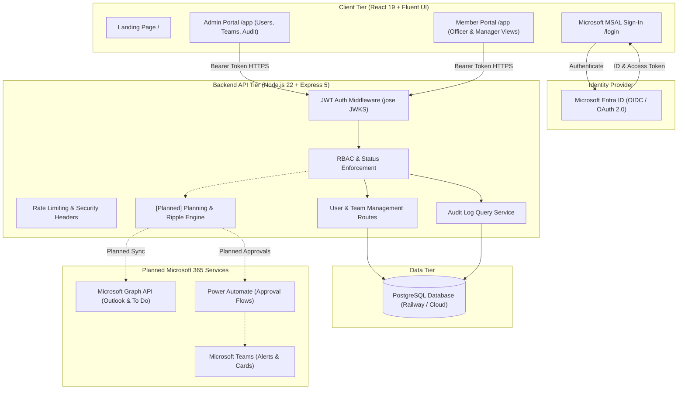
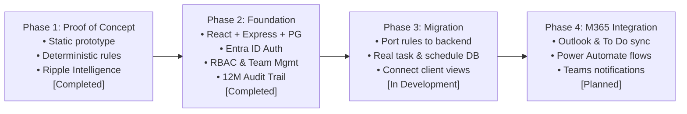

# SyncAI — Smart Work Planner

**Know what matters. Understand what changes. Choose the safer plan.**

SyncAI is an AI-enabled **Smart Work Planner** developed for Town Council Property Officers and their supervisory managers. Built by **IT2134 Team 24** for the **EM Services (EMS) Challenge PS 12i — Smart Work Planner (Microsoft-based)** (NYP School of IT × SCCCI × EM Services Techno Semester, October–November 2026).

---

## The Operational Problem

Town Council Property Officers operate in high-density residential estates, managing 2,500 to 2,700 housing units each. In their daily operations, officers face heavy, competing demands:

- **Genuine public safety hazards:** Lift faults, concrete spalling, exposed electrical wiring, and chute fire risks that demand immediate physical response.
- **Strict statutory and compliance deadlines:** Periodic inspections, lift certifications (BCA), fire safety compliance (SCDF), and Town Council co-funding claim cut-offs that cannot slip without legal exposure.
- **Real service impact vs. loudest-voice bias:** Demanding residents frequently escalate complaints; however, complaint frequency alone does not indicate genuine risk or urgency.
- **Long-term consequences of deferral:** Unaddressed minor defects (such as ceiling seepage) can rapidly penetrate structural rebar, resulting in concrete spalling and major emergency repair expenditures.
- **Time and capacity bottlenecks:** Officers spend substantial portions of their day on resident communication, contractor inspections, and administrative invoice verification, leaving tight margins when emergencies arise.

**SyncAI does not replace the Operations Command Centre (OCC).** The OCC provides situational oversight of where officers are and what events are active. SyncAI complements this by providing forward-looking operational planning and impact intelligence: helping officers and managers structure achievable days and understand the ripple effect before schedules change.

---

## Four Team Workstreams & Interconnected Architecture

SyncAI is **one interconnected Smart Work Planner**, not four independent tools. Developed by **IT2134 Team 24**, the system unites four primary feature workstreams into a single operational workflow:

| Team Member | Feature Workstream | Primary Responsibilities |
| --- | --- | --- |
| **Charlisa Tan** | **Smart Planning** | Calendar-aware scheduling, daily and weekly planning, officer availability, and realistic workload arrangements around meetings and travel buffers. |
| **Felicia Tan** | **Task Visibility** | Task and case visibility, Case Action Centre, Operational Loose-End Intelligence, case progress, blockers, outstanding commitments, and follow-ups. |
| **Shamreen Rizmiya** | **Ripple Intelligence** | Task dependency analysis, disruption impact and downstream consequences, alternative scheduling, and reassignment strategies. |
| **Nann** | **Approvals & Audit** | Management approval workflows, approval hierarchy, decision tracking, and immutable auditability. |

> *Note on Team Allocation:* These areas define primary ownership. Individual subfeatures remain subject to implementation feasibility (not every exploratory brainstorming idea is required to be built). All members contribute across full-stack development, testing, and documentation.

### The Interconnected Operational Loop

The four workstreams connect into a continuous closed-loop operational cycle:

```
    ┌────────────────────────────────────────────────────────┐
    │ 1. Task Visibility (Felicia Tan)                       │
    │    • Surfaces operational cases, blockers, commitments │
    │    • Follow-Up Radar flags unresolved loose ends       │
    └───────────────────────────┬────────────────────────────┘
                                │ Tasks & Case Checkpoints
                                ▼
    ┌────────────────────────────────────────────────────────┐
    │ 2. Smart Planning (Charlisa Tan)                       │
    │    • Fits work around Outlook meetings & travel buffer │
    │    • Generates realistic daily and weekly schedules    │
    └───────────────────────────┬────────────────────────────┘
                                │ Schedule Conflicts & Delays
                                ▼
    ┌────────────────────────────────────────────────────────┐
    │ 3. Ripple Intelligence (Shamreen Rizmiya)              │
    │    • Traces downstream dependency cascade              │
    │    • Evaluates 3 alternatives (No Action/Shift/Assign) │
    └───────────────────────────┬────────────────────────────┘
                                │ Selected Reassignment / Shift
                                ▼
    ┌────────────────────────────────────────────────────────┐
    │ 4. Approvals & Audit (Nann)                            │
    │    • Routes restricted changes to assigned manager     │
    │    • Enforces self-approval guardrails & audit trail   │
    └───────────────────────────┬────────────────────────────┘
                                │ Authorised Decision Applied
                                ▼
       [Updates Case Journey, Officer Schedule & Audit Log]
```

1. **Task Visibility** identifies cases, blockers, and outstanding commitments.
2. **Smart Planning** builds realistic plans using tasks, calendars, and officer availability.
3. **Ripple Intelligence** analyses disruption consequences and compares feasible alternatives.
4. **Approvals & Audit** routes changes requiring authorisation to the correct manager and records the decision.
5. **Approved changes feed back** into task visibility, schedules, case histories, and audit records.

Shared task IDs (`t101`), case IDs (`case-001`), officer IDs (`o1`), team IDs (`team-1`), deadline timestamps, and approval states serve as the unified data foundation connecting these workstreams.

### Operational Reality & Client Criteria Alignment

SyncAI's architecture aligns with essential Town Council operating principles:

- **Client Prioritisation Criteria:** Reflects EM Services' four-tier framework (**1. Service → 2. Safety → 3. Residents' well-being → 4. Actual concern / urgency**).
- **Statutory & Safety Non-Negotiables:** Routine service requests **never** override imminent physical danger (lift breakdowns, falling concrete) or statutory compliance deadlines (BCA, SCDF). Repeat complaint volume awards **0 priority points** to prevent loudest-voice bias.
- **SLA & Appointment Protection:** Monitors strict SLA cut-offs and locks in fixed resident appointments during disruption rescheduling.
- **Authorised Management Hierarchy:** Front-line officers cannot self-approve restricted schedule changes or cross-officer reassignments; decisions require supervisory review.
- **Auditable Communications:** Simulated notification adapters across In-App, Microsoft Teams (proposed), and WhatsApp (proposed) omit sensitive resident data and route users to authenticated in-app approval links (`syncai://approval/...`).
- **OCC Complementarity:** SyncAI complements the Operations Command Centre by providing forward-looking schedule planning and consequence forecasting, without duplicating the OCC's real-time situational tracking.

---

## Flagship USP & Signature Differentiator

### Flagship USP: Operationally Aware AI Scheduling

Unlike generic productivity apps that sort tasks merely by due date or complaint volume, SyncAI plans work around operational reality across three core capabilities:

1. **Consequence-Aware Prioritisation:** Ranks tasks by evaluating genuine safety hazards (+20 pts), mandatory statutory compliance (+25 / +15 pts), service impact (+8 pts), and long-term consequences of delay (+12 pts). Repeat complaints award **0 priority points**—keeping volume visible without distorting operational focus.
2. **Capacity-Aware Scheduling:** Validates task duration estimates against an officer's actual working hours, Outlook meetings, lunch breaks, and travel buffers, proactively flagging mathematically impossible conflicts.
3. **Operational Ripple Intelligence (Signature Proposed Differentiator):** Evaluates how disruptions, delays, or reassignments propagate across multi-level task dependencies, officer capacity, and statutory deadlines before any changes are committed.

```
┌─────────────────────────────────────────────────────────────────────────┐
│                      OPERATIONAL RIPPLE INTELLIGENCE                    │
├───────────────────┬─────────────────────────┬───────────────────────────┤
│ 1. Disruption     │ 2. Cascade Evaluation   │ 3. Three Alternatives     │
│    Trigger        │    & Dependencies       │    Side-by-Side           │
├───────────────────┼─────────────────────────┼───────────────────────────┤
│ • Urgent safety   │ • Multi-level traversal │ • Alternative A:          │
│   incident (lift) │   (t103 → t104 → t112)  │   No Action               │
│ • Officer medical │ • Capacity deficits     │ • Alternative B:          │
│   leave (MC)      │ • Protected statutory   │   Reschedule Lower-Impact │
│ • Extra compliance│   deadlines (BCA/SCDF)  │ • Alternative C:          │
│   assignment      │ • Potential defect risk │   Reassign Eligible Work  │
└───────────────────┴─────────────────────────┴───────────────────────────┘
```

### Three-Alternative Scenario Comparison

When an operational disruption occurs, SyncAI evaluates three distinct operational paths:

- **Alternative A: No Action (Baseline):** Demonstrates the operational exposure of doing nothing—highlighting unmitigated deadline slips, breached compliance dates, and customer friction.
- **Alternative B: Reschedule Lower-Impact Work:** Retains work with the assigned officer by deferring routine admin or non-critical inspections to protect mandatory compliance deadlines.
- **Alternative C: Reassign Eligible Work:** Identifies alternative officers with spare capacity and enforces domain certifications (e.g. lift specialist), flagging unqualified officers even if they have available hours.

> **Human-in-the-Loop Decision Support:** AI generates explainable recommendations, but estate managers and property officers review and approve every schedule adjustment before it takes effect.

---

## Current Implementation Status

SyncAI maintains a strict separation between its interactive proof-of-concept prototype and the production full-stack application:

| Capability / Tier | Static Prototype (`prototype/`) | Full-Stack Application (`client/` & `server/`) | Planned / Roadmap |
| --- | --- | --- | --- |
| **User Interface** | HTML5, CSS3, vanilla JavaScript ES modules (Fluent 2 inspired) | React 19, Vite, Microsoft Fluent UI components | Continuous UX refinement |
| **Authentication** | Simulated role switching (`localStorage` session, 5 demo accounts) | **Implemented / locally tested:** Microsoft Entra ID (MSAL) with JWT JWKS signature validation | Multi-tenant policy configuration |
| **Data Persistence** | Browser `localStorage` seeded with fictional Town Council data | **Implemented / locally tested:** PostgreSQL with parameterized queries and migrations | Entity tables for tasks, cases, and schedules |
| **Access Control & RBAC** | **Implemented:** Strict role separation (`admin`, `manager`, `member`) & account status screens (`pending`, `disabled`) | **Implemented / locally tested:** Admin approval queue, role enforcement (`admin`, `manager`, `member`), status gates (`pending`, `disabled`) | Granular zone/estate permissions |
| **Team Management** | Hard-coded officer zones and skills with assignment history | **Implemented / locally tested:** Admin team management, manager assignment, member placement | Dynamic multi-team assignment |
| **Audit Logging** | In-memory activity log & approval decision audits | **Implemented / locally tested:** 12-month append-only audit trail in PostgreSQL | Export to external compliance log |
| **Task & Case Visibility (Category C)** | **Implemented:** Case Action Centre, List & Kanban views, 8-rule Loose-End Detector ("Follow-Up Radar"), Case Journey timeline, Closure Readiness Checker, simulated AI brief | **Implemented / locally tested:** Read-only Microsoft To Do task inspection via Graph (`Tasks.Read`); SyncAI task engine in development | Persistent task/case tables and API endpoints |
| **Smart Planning (Category B)** | **Implemented:** Daily & weekly schedule generator, time-blocking around meetings/appointments, schedule preferences dialog | **Implemented / locally tested:** Read-only Outlook Calendar sync via Graph (`Calendars.Read`) in client; server planning engine in development | Server-side calendar-aware scheduling |
| **Ripple Intelligence (Category D)** | **Implemented:** Multi-level dependency analysis, SLA risk, capacity deficit evaluation, and 3-alternative scenario comparisons (`ripple.js`) | Conceptual preview in How SyncAI Decides | Migration to Express API planning service |
| **Approvals & Audit (Category G)** | **Implemented:** Hierarchical manager approval workflow, self-approval prevention, simulated In-App/Teams/WhatsApp alerts | **Implemented / locally tested:** Admin user approval queue, PostgreSQL audit log; manager schedule approval API in development | Power Automate flows, Teams adaptive cards |
| **M365 & Notifications** | Simulated Outlook meetings, To Do tasks, and multi-channel alerts (In-App, Teams, WhatsApp) | **Implemented (read-only):** Each active member/manager can connect their own Outlook calendar (`Calendars.Read`) and To Do lists (`Tasks.Read`); nothing stored | Bi-directional M365 sync, Power Automate, Teams cards |
| **OCC Complementarity** | Fictional mock records labelled `OCC (Mock)` | Not connected | Real-time event ingestion adapter |
| **Language Features** | Deterministic keyword and regex extraction | Help-guide Q&A preview (4 languages) | Optional Azure OpenAI assistance |

*Note: The prototype's intelligence is deterministic and rules-based. It is not an unverified black-box predictive ML model, ensuring all scheduling advice is explainable, safe, and auditable.*

---

## System Architecture



See [docs/architecture.md](docs/architecture.md) for full architectural specifications, security controls, and data schemas.

---

## Role-Based Access Control

SyncAI supports three distinct application roles:

| Application Role | Operational Persona | Key Capabilities |
| --- | --- | --- |
| **System Administrator** (`admin`) | Technical Administrator | Approves new accounts, assigns roles, manages team memberships, monitors 12-month audit activity log. In accordance with data minimisation principles, administrators inspect compliance aggregates and audit logs, with zero access to private officer calendars or operational resident casework. |
| **Manager** (`manager`) | Supervisory Manager / Estate Manager | Oversees assigned team members across supervised zones, reviews team capacity, evaluates What-If disruption simulations, reviews reassignment requests, and manages statutory compliance risks. |
| **Team Member** (`member`) | Property Officer / Front-Line Staff | Manages personal daily schedules, views recommended task priorities with explainable score breakdowns, performs site inspections, tracks case checkpoints, and requests emergency schedule adjustments. Operates under strict case isolation (sees only own work). |

> **Account Statuses vs. Roles:** `pending` and `disabled` are account lifecycle states, not roles. New sign-ins enter a `pending` state awaiting administrator role assignment. Disabled accounts are blocked from operational features.  
> **Human-in-the-Loop Governance:** Front-line officers cannot self-approve restricted schedule changes or cross-officer reassignments. Management sign-off is mandatory for all schedule shifts affecting SLAs. Browser-only prototype access controls demonstrate UI behaviour; production security is cryptographically enforced on the Express backend.

---

## Repository Structure

```text
SyncAI/
├── client/                 # Full-stack React 19 + Vite frontend (Fluent UI, MSAL)
│   ├── src/                # Portals, components, i18n translations, MSAL config
│   └── README.md           # Client setup, environment variables, and architecture
├── server/                 # Full-stack Node.js 22 + Express 5 backend API
│   ├── src/                # Auth middleware, RBAC rules, PostgreSQL models
│   └── README.md           # Server setup, database migrations, and security
├── prototype/              # Interactive proof-of-concept prototype (vanilla JS)
│   ├── js/                 # ai.js, planner.js, simulation.js, ripple.js
│   ├── site/               # Prototype marketing website and demo sign-in
│   ├── tests/              # Automated tests for rules and ripple engines
│   └── README.md           # Prototype user guide and scenario walkthroughs
├── docs/                   # Engineering and client documentation
│   ├── architecture.md     # System architecture, security model, and EMS requirements
│   └── demo-script.md      # 7-minute presentation walkthrough of Ripple Intelligence
├── CONTRIBUTING.md         # Contribution standards, branch conventions, review checklist
├── SECURITY.md             # Vulnerability disclosure, PDPA compliance, secret handling
└── CODE_OF_CONDUCT.md      # Community standards (Contributor Covenant v2.1)
```

---

## Getting Started

### 1. Interactive Static Prototype

The prototype requires no build steps or external dependencies (Python 3 standard library only):

```bash
# Start local prototype web server
python prototype/serve.py
```

- **Website:** <http://localhost:8765/site/>
- **Sign-In:** <http://localhost:8765/site/login.html> (Demo accounts provided on page)
- **Portal:** <http://localhost:8765/>

Run the automated prototype test suite (Node.js 20+ built-in test runner):

```bash
node --test "prototype/tests/*.test.mjs"
# Verified: 88 automated tests pass across 8 suites (cases, rules, ripple, task capture, smart planning, user journey, client requirements, status codes)
```

### 2. Full-Stack Application

Requires **Node.js 22 or later** and an accessible PostgreSQL instance.

#### Backend Setup (`server/`)

```bash
cd server
npm install
cp .env.example .env
# Configure DATABASE_URL and ENTRA_CLIENT_ID in server/.env
npm run dev
# Starts Express API at http://localhost:3000/api
```

Run backend unit and security tests:

```bash
npm test
# Verified: 21 automated tests pass (auth, RBAC, teams, audit)
```

#### Frontend Setup (`client/`)

```bash
cd client
npm install
cp .env.example .env
# Configure VITE_ENTRA_CLIENT_ID and VITE_ENTRA_TENANT_ID in client/.env
npm run dev
# Starts Vite dev server at http://localhost:5173
```

Run frontend component and logic tests:

```bash
npm test
# Verified: 16 automated tests pass (help guide, i18n, time, http status)
```

---

## Demonstration Links

- **Main Repository:** <https://github.com/feliciatanxl/SyncAI>
- **Static Prototype (GitHub Pages):** <https://feliciatanxl.github.io/SyncAI/site/index.html>

*(Note: Live deployment links to cloud-hosted Railway containers remain internal for development and are subject to Azure tenant registration.)*

---

## Scope Boundary & Problem Statement Alignment

SyncAI is specifically engineered for **EM Services Challenge PS 12i — Smart Work Planner (Microsoft-based)**.

- **In Scope (PS 12i):** Property Officer task scheduling, explainable priority scoring, capacity-aware planning, What-If disruption simulations, and Operational Ripple Intelligence.
- **Out of Scope:**
  - PS 12g Operations Hub (resident multi-channel complaint intake and case consolidation).
  - PS 12h Project Tracker (management-level capital project Gantt tracking and contractor procurement).
  - Payroll, HR records, medical diagnoses (absences record only general categories such as MC or leave).
  - Production write access to live Town Council Enterprise systems without explicit EMS authorization.

*(Note: Historical prototype exploratory pages `hub.js`, `sources.js`, and `projects.js` have been retired from primary navigation to maintain strict PS 12i focus while preserving foreign-key data integrity.)*

---

## Development Roadmap



---

## Documentation Navigation

- [System Architecture](docs/architecture.md) — Detailed technical specifications, data models, and security boundaries.
- [Presentation Demo Script](docs/demo-script.md) — A 7-minute structured walkthrough of Operational Ripple Intelligence.
- [Prototype Guide](prototype/README.md) — Developer documentation, rules logic, and scenario references.
- [Client Frontend Guide](client/README.md) — React architecture, MSAL integration, and component library.
- [Server Backend Guide](server/README.md) — Express API routes, PostgreSQL schema, and security controls.
- [Contributing Guidelines](CONTRIBUTING.md) — Git workflow, coding standards, and review checklists.
- [Security Policy](SECURITY.md) — Responsible disclosure, secret management, and PDPA safeguards.
- [Code of Conduct](CODE_OF_CONDUCT.md) — Community standards and professional expectations.
- [License](LICENSE) — MIT License.
