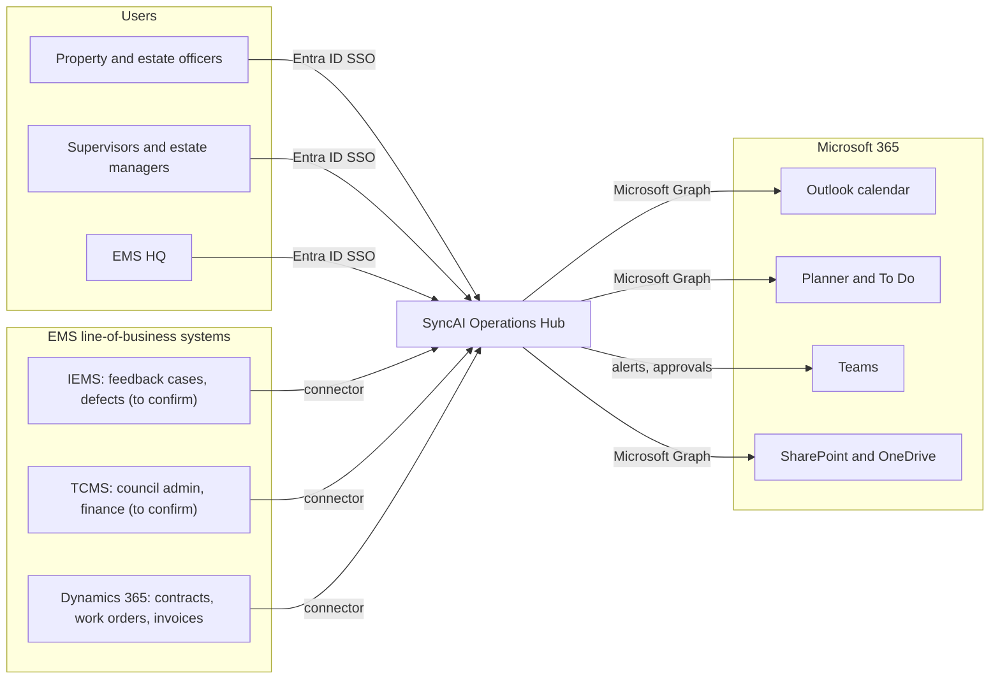
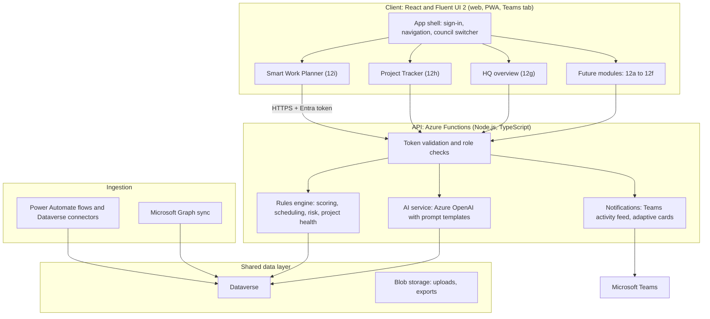
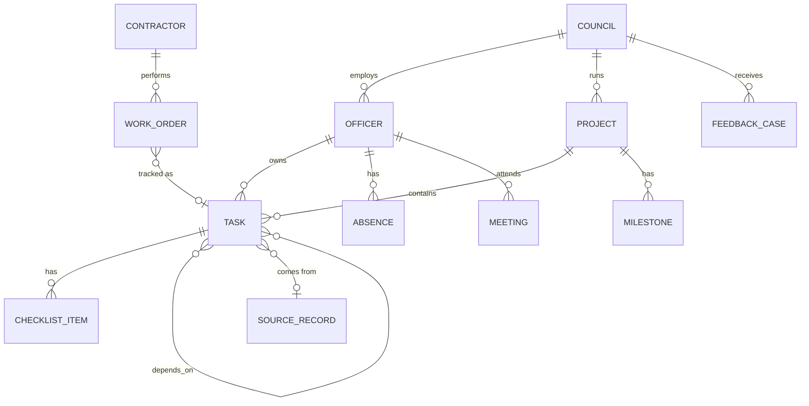
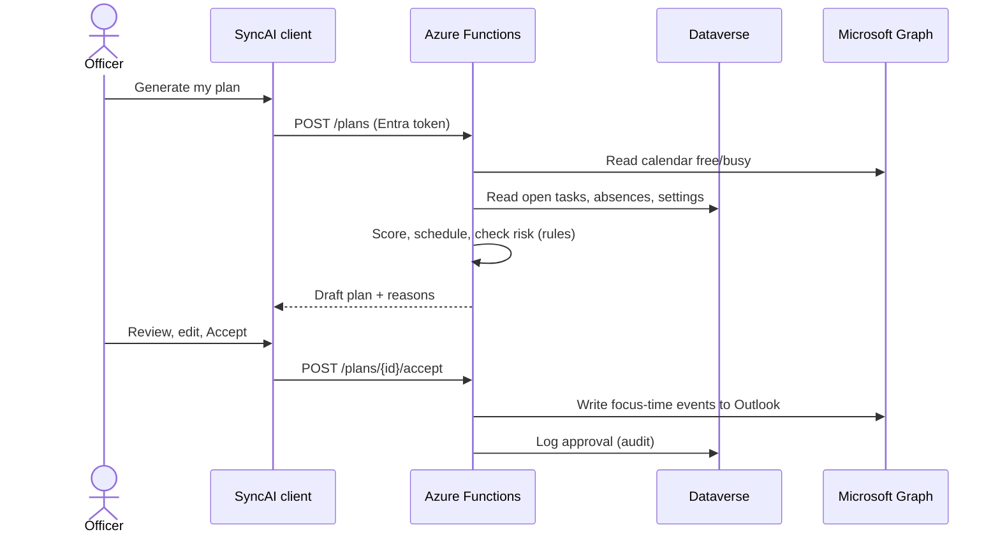
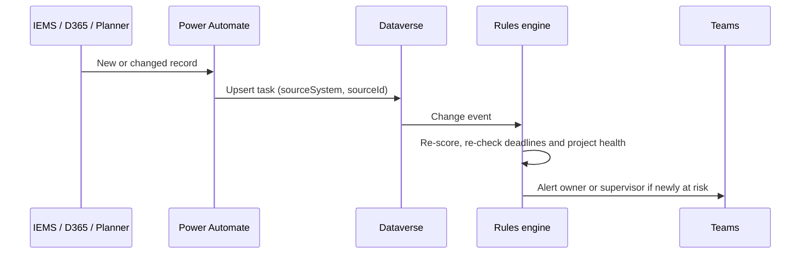

# SyncAI architecture

SyncAI is a Microsoft-based **Town Council Operations Hub** (EMS statement 12g). The Smart Work Planner (12i) and Project Tracker (12h) are its first two modules. This document describes the target production architecture and how the current prototype maps onto it.

> **Status:** proposal for the EMS briefing (week of 2 Nov 2026). What IEMS and TCMS contain, and how they can be reached, are **assumptions to confirm with EMS**. They are marked ⚠️ below.

## 1. Goals from the brief

| 12g asks for | How the architecture answers it |
| --- | --- |
| One Microsoft-based hub over IEMS, TCMS, D365 and SharePoint | A single web app on Azure, signed in with Microsoft Entra ID, reading from one shared data layer |
| A shared data layer | **Microsoft Dataverse** holds the common entities (councils, officers, tasks, projects, cases, contractors), fed by connectors from each source system |
| Built-in intelligence | Deterministic rules for scoring, scheduling and risk (explainable), plus **Azure OpenAI** for language features only |
| Role-based sharing across Town Councils and EMS HQ | Entra ID security groups map to four roles; Dataverse row-level security scopes data by council |
| Mobile-first | Responsive Fluent 2 web app, installable as a PWA and embeddable as a Microsoft Teams tab |
| Architecture plus a working slice; other statements become modules | Modules share the data layer and the shell. The prototype is the working slice: Planner, Projects, HQ overview and Data sources |

## 2. System context

## 3. Logical architecture

**Why these choices**

- **Dataverse** is Microsoft's managed data platform with built-in row-level security, auditing and ready-made connectors to Dynamics 365 and SharePoint. That makes it the natural shared data layer for a Microsoft-only brief.
- **Rules first, LLM second.** Priority scores, schedules, risk and project health come from deterministic rules, so every result is explainable and repeatable. Azure OpenAI is used only to read and write language: turning text into tasks, meeting minutes into actions, and drafting briefings. A person approves every change.
- **Azure Functions** keep the API small and serverless. Each module adds its own endpoints without a shared monolith.
- **Power Apps was considered** for speed. A React + Fluent UI client was chosen for the drag-and-drop board, the timeline and the planner calendar, which are hard to build well in Power Apps. Simple modules (for example 12c compliments intake) could still be Power Apps screens embedded in the hub.

## 4. Shared data model

| Entity | Main source | Notes |
| --- | --- | --- |
| Council, officer, role | Entra ID groups + HR list | One security group per council and role |
| Task | Planner / To Do, IEMS cases ⚠️, D365 work orders, SyncAI | `sourceSystem` + `sourceId` keep a link back to the original record |
| Project, milestone, checklist | SyncAI (Dataverse) | New data owned by the hub |
| Meeting, free/busy | Outlook via Graph | Read only; approved plan blocks are written back as calendar events |
| Absence | HR / Outlook out-of-office | Stored as "MC" or "leave" only, never medical details |
| Feedback case, defect | IEMS ⚠️ | Feeds performance tracking (12d) and compliments (12c) later |
| Contractor, work order, invoice | Dynamics 365 | Feeds contractor tasks and lift defects (12b) later |
| Document, minutes | SharePoint | Read on demand with the user's permission |

## 5. Roles and data sharing

| Role | Sees | Can change |
| --- | --- | --- |
| **Officer** | Own tasks, own plan, projects they are part of | Own tasks and plan |
| **Supervisor** | Everything in their council: team workload, all tasks, projects, simulations | Assign and reassign work, approve plans, create projects |
| **Council manager** | Their council's dashboards and projects | Project priorities and targets |
| **EMS HQ** | Roll-ups across all councils: counts, risk, progress, utilisation. **No individual officer names or tasks** | Nothing operational; read-only oversight |

Enforced in three places: Entra ID group claims in the token, role checks in every API function, and Dataverse row-level security by council, so a bug in the client cannot leak another council's data.

## 6. Key flows

**Generate a daily plan (12i)**

**Source system to task (ingestion)**

## 7. Security and privacy

- **Identity:** Microsoft Entra ID single sign-on with MFA; no SyncAI passwords. The prototype's email and password page is a mock.
- **Least privilege:** Graph scopes limited to `Calendars.ReadWrite`, `Tasks.ReadWrite`, `Group.Read.All` and `Sites.Selected`; connectors use managed identities, not stored secrets.
- **Data protection:** data stays in the EMS Microsoft 365 / Azure tenant in Singapore regions; encrypted at rest and in transit.
- **AI safety:** Azure OpenAI with no training on customer data; prompts never include medical details; every AI output is a suggestion that a person approves; all approvals are audited.
- **PDPA:** minimal personal data; absences recorded as MC or leave only; HQ sees aggregates only.

## 8. Prototype mapping

The prototype in [`prototype/`](../prototype/) is a browser-only working slice with fictional data. It mirrors the architecture so that each part can be replaced by its production equivalent.

| Production | Prototype |
| --- | --- |
| React + Fluent UI client | Vanilla HTML / CSS / JavaScript with a Fluent 2-inspired design (`prototype/js/pages`) |
| Entra ID sign-in and role claims | Mock sign-in page storing the role in browser storage (`prototype/site/login.html`) |
| Rules engine (Azure Functions) | `js/ai.js`, `js/planner.js`, `js/simulation.js`, `projectHealth` in `js/pages/projects.js` |
| Azure OpenAI | Keyword and pattern rules in `js/ai.js` |
| Dataverse | `localStorage` state seeded from `js/data.js` |
| Power Automate / Graph connectors | Simulated sources on the **Data sources** page |
| Council roll-ups (row-level security) | **HQ overview**: one council computed live, the others sample figures |

## 9. Delivery phases

| Phase | Scope |
| --- | --- |
| **MVP** | Entra sign-in; Outlook and To Do sync; Smart Work Planner; Project Tracker; one council |
| **Phase 2** | Teams alerts and approvals; Planner sync; D365 contractor work orders; HQ overview for all councils |
| **Phase 3** | IEMS and TCMS connectors ⚠️; modules for other EMS statements (12b lift spot-checks, 12c compliments, 12d early warning) on the same data layer |

## 10. Questions for the EMS briefing

1. What data do IEMS and TCMS hold, and do they offer APIs, database access or exports?
2. Is Dataverse already licensed in the EMS tenant, or is SharePoint Lists the expected data store?
3. How are Town Councils separated today: one tenant with groups, or several tenants?
4. Which roles exist at HQ, and what may HQ see about individual councils and officers?
5. Is a Teams app acceptable as the main mobile channel, or is a separate mobile app expected?
