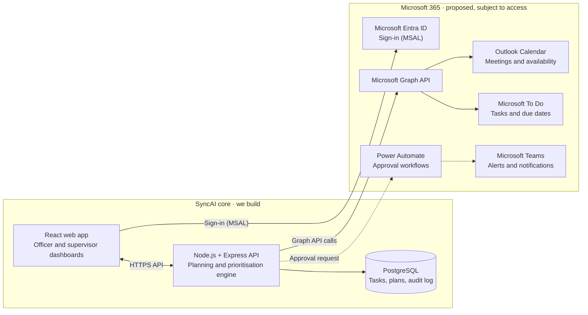
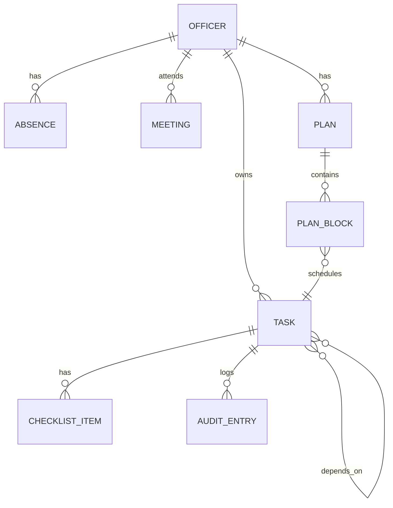
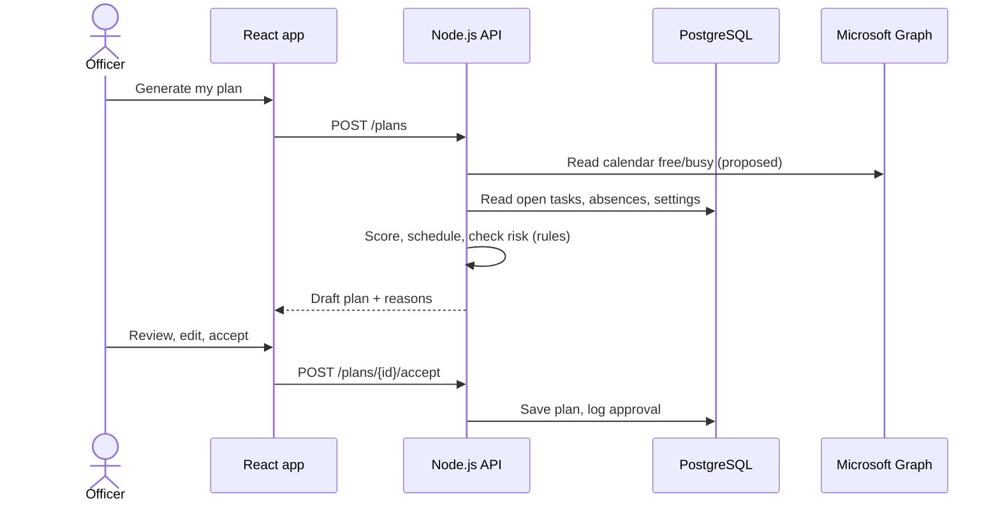

# SyncAI architecture

SyncAI is a Smart Work Planner for Town Council Property Officers (EMS problem statement **12i**, Team 24, IT2134-05). This document describes the proposed architecture, what EM Services told us, and how the current prototype maps onto the build.

> **Status:** Week 5 proposal (Nov 2026). Everything on the Microsoft side is **proposed**: tenant access, API permissions, licensing and deployment requirements still need confirming with EMS. The prototype uses mock Microsoft 365 connections. We do not claim GCC compliance.

## 1. Goals from the brief

| 12i asks for | How the architecture answers it |
| --- | --- |
| Organise officers' tasks and schedules | Tasks stored in SyncAI, with Outlook Calendar and Microsoft To Do read through Microsoft Graph where permitted |
| Prioritise work by deadline and effort | A rules-based planning engine in the API scores each task on safety, mandatory deadlines, service impact and long-term consequences, and scheduling feasibility, and explains every score |
| Suggest a realistic daily or weekly plan | The engine time-blocks tasks around meetings, working hours and estimated durations; a person reviews and approves the plan |

**USP: Operationally Aware AI Scheduling.** Understand operational priorities, build achievable plans, explain necessary adjustments.

## 2. Proposed architecture



| Component | Role |
| --- | --- |
| **React web app** | Task management, daily planning and workload visibility for officers and supervisors |
| **Node.js + Express API** | Scheduling logic, priority scoring, workload calculations and the backend APIs. The backend makes the Graph calls, so the browser never reaches organisational data directly |
| **PostgreSQL** | Tasks, plans, settings and the audit log of recommendations, approvals and overrides |
| **Microsoft Entra ID** | Proposed organisational sign-in using MSAL |
| **Microsoft Graph** | Authorised access to Outlook Calendar (meetings, free/busy) and Microsoft To Do (tasks, due dates), synced where permitted |
| **Power Automate** | Proposed approval flows for schedule or assignment changes |
| **Microsoft Teams** | Proposed alerts to officers and supervisors |
| **Azure OpenAI** | Optional, later phase, for language features such as turning text into tasks. Not needed for the first working prototype |

**Why these choices**

- **Rules first, LLM second.** Priority scores, schedules and risk come from deterministic rules, so every result is explainable and repeatable. A language model would only read and write text.
- **React + Node.js rather than Power Apps.** The drag-and-drop board, planner calendar and What-If comparisons are hard to build well in Power Apps. "Microsoft-based" is met by integrating Microsoft 365 (Entra ID, Graph, Power Automate, Teams) rather than rebuilding everything on Power Platform.
- **Power Automate for approvals, not for the planner.** Scoring and scheduling stay in the API, where they can be tested and explained. Calling our own API from a flow may need a premium or custom connector; EMS said it will handle licences.
- **Earlier lift-inspection prototypes (PS 12b)** reportedly had workable logic but struggled to fit the Microsoft ecosystem. That is why Microsoft integration is designed in from the start.
- **Ready for a restricted environment, not GCC-compliant.** A clean API boundary, environment-based configuration, role-based authorisation, audit logging and secret management keep a later move to a government cloud possible without claiming compliance now.

## 3. Priority logic

Four operational factors, weighed together. These are decision factors, not an officially approved four-step ranking; the weights below are our proposal and will be validated with EMS.

| Factor | What the planner considers | Prototype today (`js/ai.js` `scoreTask`) |
| --- | --- | --- |
| **Safety** | Genuine risks to residents, staff and property | Safety flag +15, the largest single flag |
| **Mandatory deadlines** | Statutory, compliance and funding-approval obligations | Statutory flag: +20 within 3 working days, +10 otherwise; kept in place during emergency re-planning |
| **Service impact and long-term consequences** | Real resident needs, operational disruption, and the cost of delaying the task. Not how vocal a resident is | High service impact +8; repeat complaints shown at **0 points** so volume is visible but never raises priority. Long-term consequences are not scored separately yet |
| **Scheduling feasibility** | Estimated durations against availability, meetings and capacity | Effort estimates, start-by deadlines, capacity checks and the schedule check |

## 4. Data model



| Entity | Source | Notes |
| --- | --- | --- |
| Officer, role | Entra ID (proposed) or seeded test accounts | Officer and supervisor roles |
| Task | SyncAI, To Do via Graph (proposed) | `sourceSystem` + `sourceId` keep a link back to the original record. Which system is the source of truth is an open question |
| Meeting, free/busy | Outlook via Graph (proposed) | Read only; approved plan blocks could be written back as calendar events |
| Absence | Entered by supervisors | Stored as "MC" or "leave" only, never medical details |
| Task-duration baselines | EMS's Property Officer time study (to be arranged) | Replaces the prototype's assumed effort baselines |
| Audit entry | SyncAI | Every recommendation, approval and manual override |

## 5. Roles

| Role | Sees | Can change |
| --- | --- | --- |
| **Officer** | Own tasks, own plan, why each task is ranked where it is | Own tasks and plan; accepts or rejects suggestions |
| **Supervisor** | Team workload, availability, scheduling risks, simulations | Assign and reassign work, approve important changes |

Changes to SLAs or how long a category of case should take are **manager** decisions, not officer ones (see §8). Role checks run in every API route, not only in the screen.

## 6. Key flows

**Generate a daily plan**



**Urgent safety task arrives**

```mermaid
sequenceDiagram
  actor Officer
  participant API as Node.js API
  participant PA as Power Automate
  actor Supervisor
  Officer->>API: New urgent safety task
  API->>API: Re-score and re-plan; protect safety and statutory work
  API-->>Officer: Revised plan: what moved, what is now late
  API->>PA: Approval request if work must be reassigned (proposed)
  PA->>Supervisor: Teams approval card
  Supervisor-->>PA: Approve or reject
  PA-->>API: Decision, logged
```

## 7. Security and privacy

- **Identity:** Entra ID single sign-on if EMS provides a tenant; mock accounts until then. The prototype's email and password page is a mock.
- **Least privilege:** Graph scopes limited to calendar and task access for the signed-in user; secrets in environment configuration, never in code.
- **AI safety:** every output is a suggestion a person approves; all approvals and overrides are audited; prompts never include medical details.
- **PDPA:** minimal personal data; absences recorded as MC or leave only; EMS said shared data will have personal details anonymised.

## 8. What EMS told us (client kickstart and written answers, Nov 2026)

| Client said | What it means for SyncAI |
| --- | --- |
| Property Officers should act first on genuine safety concerns. A resident who is particularly vocal is not, by itself, a reason for higher priority | Safety is the largest flag. Repeat complaints show in the score breakdown at 0 points |
| Statutory and compliance deadlines must be met, such as project funding-approval dates and compliance dates under the Town Council Act | Statutory flag on tasks; emergency re-planning keeps statutory work due today in place |
| Service needs and potential long-term consequences matter | "High service impact" covers residents and operations. Long-term consequences are named in the priority logic and should get their own scoring factor in the build |
| EMS will guide teams on prioritisation rules; there is no agreed formula | Our weights are a proposal to validate with EMS |
| The Operations Command Centre already sees where officers are and what they are working on | SyncAI adds forward-looking planning on top of that visibility. Access is not confirmed; the prototype uses simulated availability |
| EMS has an analysis of how long Property Officers spend on tasks, available through Albert | Planned replacement for our assumed effort baselines. Not received yet |
| EMS is reviewing Property Officers' job design and welcomes ideas | SyncAI is designed around actual Property Officer responsibilities and realistic task durations |
| Each Property Officer manages 2,500–2,700 units. Most time goes on talking to residents and on admin: matching contractor claims to site work and the term contract before payment | Admin and resident-feedback effort feed the overload and "falling behind" checks; the time study will show where to automate |
| Microsoft is the baseline: every Town Council has Power Automate and Copilot; more depends on each council. EMS will handle licences | Power Automate approvals and Teams alerts are in the proposed stack; licensing is not treated as a blocker |
| Feedback data is real time; admin and analysis extracts are pulled monthly or bi-monthly | Scheduling uses live task data; workload trends can use periodic extracts |
| When repairs overrun the SLA, whether the SLA is realistic is a manager decision. EMS wants to know how long each category of case really takes | Re-plans need approval; estimated-vs-actual effort by category on **AI Insights** gives managers the evidence |
| 12i works at the operations level: officers' business-as-usual, day-to-day tasks. 12h works at the management level and tracks one-off initiatives | SyncAI stays on daily work for officers and their supervisors. Project tracking is out of scope |
| Each problem statement has a dedicated account owner; teams are encouraged to propose approaches and get feedback | Validate priority rules and demo scenarios with our account owner |
| Contractor communication over calls and WhatsApp should become trackable for audits | Noted for a later phase |

**From other EMS problem statements:** PS 12g covers consolidating multichannel resident feedback, so SyncAI does not duplicate case consolidation. PS 12h described a hierarchy of officers, managers/account owners and senior management, which informs our officer and supervisor views.

## 9. Prototype mapping

The prototype in [`prototype/`](../prototype/) is a browser-only slice with fictional data. Each part maps to a piece of the build.

| Build | Prototype |
| --- | --- |
| React web app ([`client/`](../client/)) | Vanilla HTML / CSS / JavaScript with a Fluent 2-inspired design (`prototype/js/pages`) |
| Entra ID sign-in | Mock sign-in page storing the role in browser storage (`prototype/site/login.html`) |
| Planning engine (Node.js API) | `js/ai.js`, `js/planner.js`, `js/simulation.js` |
| PostgreSQL | `localStorage` state seeded from `js/data.js` |
| Graph, Power Automate, Teams | Mock Outlook meetings, simulated alerts and approvals |
| Azure OpenAI | Keyword and pattern rules in `js/ai.js` |

The prototype also has **Projects**, **HQ overview** and **Data sources** pages from an earlier, wider concept that covered 12g and 12h. They are outside our 12i scope and are not part of the proposed build.

## 10. Roadmap

| Stage | When | Scope |
| --- | --- | --- |
| **1. Proposal and discovery** | Week 5 (current) | Confirm scope, roles, client priorities and prototype direction |
| **2. Core planning engine** | Date TBC | Build and test prioritisation, task-duration estimates and realistic schedule generation; validate priority rules with EMS |
| **3. Integration and workflow validation** | Date TBC | Explore authorised Microsoft 365 integration, try approvals and notifications, test scheduling scenarios |
| **4. Evaluation and final demonstration** | Date TBC | Usability testing, refine explanations, evaluate recommendations (with the time-study data if available), documentation |

**Team workstreams:** (1) task intelligence and officer experience, (2) smart scheduling and workload planning, (3) Microsoft integration and supervisor workflow. Architecture, testing, documentation and the presentation are shared.

## 11. Open questions for EMS

1. Is GCC compatibility a future consideration for this proof of concept, or is deployment within GCC expected?
2. Is there an approved Microsoft 365 tenant and app-registration process we can use to test Graph, or should we demonstrate integrations with simulated data?
3. Are there data-classification, security, network-access or deployment restrictions we should design for?
4. Should SyncAI keep its own task records or act as a planning layer over To Do and Outlook, and which system is the source of truth when they differ?
5. What can we receive from the task-duration analysis (categories, average times, differences between officers), and when?
6. Can the Operations Command Centre provide task assignments or availability for the prototype, or should we keep simulated data?
