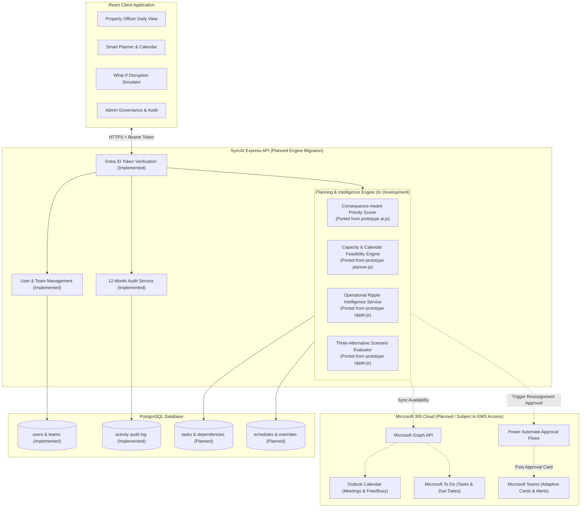

# SyncAI Architecture Specification

SyncAI is an AI-enabled **Smart Work Planner** developed for Town Council Property Officers and their supervisory managers. Built for **EM Services (EMS) Challenge PS 12i — Smart Work Planner (Microsoft-based)** (IT2134 Team 24, November 2026).

This document details the architectural design of SyncAI, separating the **implemented full-stack foundation**, the **implemented static prototype intelligence**, and the **planned Microsoft 365 and backend integrations**.

---

## 1. Architectural Objectives & Problem Statement Alignment

| PS 12i Requirement | Architectural Solution | Implementation Status |
| --- | --- | --- |
| **Organise tasks and schedules** | Centralised task management with time-blocking around calendar commitments, meetings, and travel buffers. | • Static Prototype: Implemented (`prototype/js/planner.js`)<br/>• Full-Stack: Team and user foundation built; task engine migration in development. |
| **Prioritise work by deadline and effort** | Explainable, deterministic priority scoring evaluating safety, statutory compliance, service impact, and long-term consequences. | • Static Prototype: Implemented (`prototype/js/ai.js`)<br/>• Full-Stack: Logic documented and tested; API port planned. |
| **Suggest realistic daily or weekly plans** | Capacity-aware scheduling engine detecting overbooked days, meeting conflicts, and mathematically impossible deadlines. | • Static Prototype: Implemented (`prototype/js/planner.js`)<br/>• Full-Stack: API port planned. |
| **Operational Ripple Intelligence (USP Differentiator)** | Multi-level dependency cascade analysis evaluating the downstream effect of disruptions and comparing 3 operational alternatives. | • Static Prototype: Implemented (`prototype/js/ripple.js`)<br/>• Full-Stack: API port planned. |
| **Enterprise Identity & Governance** | Microsoft Entra ID single sign-on, role-based access control, admin approval workflows, and append-only audit logging. | • Full-Stack: **Implemented** in React (`client/`) and Express (`server/`) with PostgreSQL. |

### Core Differentiators

- **Flagship USP — Operationally Aware AI Scheduling:** Unlike traditional schedulers that blindly sort by due date or complaint frequency, SyncAI plans around operational consequence, statutory non-negotiables, and physical capacity.
- **Signature Differentiator — Operational Ripple Intelligence:** Understands how delaying an inspection or shifting an officer cascades across secondary inspections, contractor work orders, and compliance certificates, providing a 3-alternative decision matrix.

---

## 2. System Architecture

To maintain clarity and engineering truthfulness, SyncAI distinguishes between the **currently implemented full-stack application** and the **target smart planning architecture**.

### Diagram 1: Implemented Full-Stack Architecture

The live full-stack system provides enterprise identity, role governance, team management, and audit logging.

```mermaid
flowchart TD
    subgraph Browser["User Browser (Single Page Application)"]
        ReactApp["React 19 + Vite + Fluent UI<br/>(Portals: Admin, Manager, Team Member)"]
        MSALClient["@azure/msal-browser<br/>Authentication Client"]
    end

    subgraph IdentityProvider["Identity Provider"]
        EntraID["Microsoft Entra ID<br/>(Personal & Work/School Accounts)"]
    end

    subgraph BackendAPI["Backend API Service (Express 5 on Node.js 22)"]
        RateLimiter["express-rate-limit<br/>(300 req / 15 min per IP)"]
        SecurityHeaders["Security Headers Middleware<br/>(CSP, HSTS, no-store, nosniff)"]
        JWTMiddleware["JWT Validation Middleware (jose)<br/>• Microsoft JWKS signature check<br/>• Issuer & Tenant validation<br/>• Audience: api://<client-id><br/>• Scope: access_as_user"]
        RBACMiddleware["RBAC & Status Enforcement<br/>• Check active status in DB<br/>• Check admin/manager role<br/>• Reject pending/disabled"]
        RouteControllers["API Route Handlers<br/>• /api/me & /api/signin<br/>• /api/users (Admin approvals)<br/>• /api/teams (Team placement)<br/>• /api/activity (12M Audit log)"]
    end

    subgraph DataStorage["Relational Database Tier"]
        PostgreSQL[("PostgreSQL Database (Hosted on Railway)<br/>• users (auth & roles)<br/>• teams & team_memberships<br/>• activity (append-only audit trail)")]
    end

    ReactApp -->|1. Trigger Sign-In| MSALClient
    MSALClient -->|2. OAuth 2.0 / OIDC Flow| EntraID
    EntraID -->|3. Issue JWT Access Token| MSALClient
    MSALClient -->|4. Return Bearer Token| ReactApp
    ReactApp -->|5. HTTPS API Request + Bearer Token| RateLimiter
    RateLimiter --> SecurityHeaders
    SecurityHeaders --> JWTMiddleware
    JWTMiddleware --> RBACMiddleware
    RBACMiddleware --> RouteControllers
    RouteControllers -->|6. Parameterized SQL Queries (pg)| PostgreSQL
```

### Diagram 2: Target Smart Planning Architecture

The target architecture incorporates the port of the prototype's deterministic rules and ripple engine into the Express API, integrated with Microsoft Graph and Power Automate.



---

## 3. Component Breakdown & Implementation State

### 3.1 Implemented Full-Stack Foundation

The production foundation is fully functional in `client/` and `server/`:

1. **Authentication & Token Handling:**
   - Single Sign-On powered by Microsoft Entra ID via `@azure/msal-browser` and `@azure/msal-react`.
   - The frontend acquires delegated access tokens for the custom scope `api://<client-id>/access_as_user`.
   - The Express server validates tokens cryptographically using `jose`, retrieving public keys dynamically from Microsoft's JWKS endpoint (`https://login.microsoftonline.com/common/discovery/v2.0/keys`).
   - Validates audience (`aud`), token issuer (`iss`), and tenant ID (`tid`).
2. **Access Control & User Approval Flow:**
   - First-time authenticated users are provisioned in PostgreSQL with a `pending` status.
   - An initial administrator is bootstrapped via `ADMIN_EMAILS` configuration; subsequent admin and manager promotions require explicit administrator action.
   - Active administrators approve users as either **Manager** or **Team Member** via `/api/users/:id`.
   - Disabled or pending accounts are blocked from accessing operational endpoints.
3. **Team Governance:**
   - Strict team domain rules implemented in `server/src/teams.js`:
     - Managers manage teams; Team Members join teams.
     - Administrators cannot join operational teams, enforcing separation of duties.
     - Each member belongs to at most one team; managers may lead multiple teams.
     - Role demotions automatically remove invalid team assignments within a single database transaction.
4. **Append-Only Audit Activity Logging:**
   - All access changes (approvals, role adjustments, status changes, team creations, member assignments) and sign-ins are recorded to PostgreSQL.
   - Records are append-only (no update or delete endpoints).
   - Automated retention cleanup purges records older than `ACTIVITY_RETENTION_DAYS` (default: 365 days) daily.

### 3.2 Implemented Static Prototype Intelligence

Demonstrated in `prototype/` with **56 passing automated tests**:

1. **Deterministic Priority Scoring & Client-Criteria Alignment (`prototype/js/ai.js`):**
   - Scores tasks on a 0–100 scale:
     $$\text{Score} = \text{Base Priority} + \text{Deadline Urgency} + \text{Safety} + \text{Statutory} + \text{Consequence} + \text{Feasibility Margin} + \text{Unblocks Others} + \text{SLA Urgency}$$
   - **Client 4-Tier Assessment Breakdown:** Maps tasks to EM Services' stated priorities:
     - *1. Service Focus:* Routine service requests, estate cleanliness, and public communications.
     - *2. Safety Focus:* Structural integrity, lift operations, fire risks, and electrical hazards.
     - *3. Residents' Well-Being:* Habitability, noise mitigation, environmental health, and water supply.
     - *4. Actual Concern / Urgency:* SLA response targets and time-critical operational escalations.
   - **Operational Safeguards:** Routine service requests **never** automatically outrank genuine imminent physical danger or statutory compliance obligations.
   - **Repeat Complaints (0 pts):** Resident complaint volume awards 0 points to prevent loudest-voice bias.
   - **Explicit Disclaimer:** Explanations clearly state that scoring weights represent Team 24's proposed operational model awaiting formal validation with EMS.
2. **SLA-Aware Scheduling & Fixed Appointment Feasibility (`prototype/js/planner.js`):**
   - Calculates working hours against Outlook meetings, lunch breaks, and travel buffers.
   - **SLA Deadline Engine:** Monitors `slaDue` cut-offs, raising high-risk alerts for breached SLAs and medium warnings for tight margins (<60m).
   - **Fixed Resident Appointments:** Protects specific site appointment windows (`appointmentTime`, `commitmentWindow`), ensuring disruption re-plans do not displace committed resident appointments.
   - Proactively flags mathematically impossible deadlines where task effort exceeds available free hours before deadline.
3. **Operational Ripple Intelligence (`prototype/js/ripple.js`):**
   - Multi-level dependency traversal with cycle detection (e.g. `t103` → `t104` → `t112`).
   - Assesses capacity deficits resulting from emergency incidents or staff medical leave.
   - Identifies exposed statutory deadlines, SLA breach risks, and long-term defect risks across the downstream cascade.
4. **Three-Alternative Scenario Evaluation (`prototype/js/ripple.js`):**
   - Side-by-side evaluation of **Alternative A: No Action**, **Alternative B: Reschedule Lower-Impact Work**, and **Alternative C: Reassign Eligible Work**.
   - Validates candidate officer qualifications against category requirements (e.g., lift specialist certifications), flagging officers who have free time but lack required domain qualifications.
   - Evaluates SLA protection and appointment protection across all three options.
   - Enforces hierarchical management governance: highlights when reassignments or schedule slips require authorised supervisory sign-off.
5. **Hierarchical Management Approval Engine (`prototype/js/state.js`):**
   - Implements structured operational change governance:
     $$\text{Team Member proposes} \longrightarrow \text{Assigned Manager reviews} \longrightarrow \text{Escalate / Approve / Reject} \longrightarrow \text{Immutable audit record}$$
   - **Self-Approval Guardrail:** A Property Officer (`team_member`) cannot self-approve restricted schedule changes or cross-officer reassignments.
   - Full audit trail captured in state with requester, approver, reason, operational impact, and decision timestamp.
6. **Multi-Channel Simulated Notification Adapter Architecture (`prototype/js/state.js` & `pages/alerts.js`):**
   - Models external notification dispatch across **In-App**, **Microsoft Teams (proposed)**, and **WhatsApp (proposed)**.
   - **Zero External API / Meta Dependencies:** Operates strictly as a local simulated adapter—no real WhatsApp Business API, Meta credentials, or external network requests.
   - **Privacy & Security Safeguards:** Previews contain zero sensitive resident personal data. Notifications contain deep links (`syncai://approval/...`) directing users into SyncAI for authenticated in-app approval and audit recording.
7. **Operations Command Centre (OCC) Data Integration Boundary:**
   - Complements OCC situational visibility rather than duplicating PS 12g Operations Hub.
   - Ingests mock emergency telemetries and incident reports clearly labelled as `OCC (Mock)`.

### 3.3 Planned Backend Migrations & Microsoft Integrations

1. **Migration of Intelligence Engine to Express:**
   - Migrate scoring, scheduling, and ripple logic from client-side prototype JavaScript into modular Node.js services.
   - Persist tasks, dependencies, officer availability, and generated plans into PostgreSQL tables.
2. **Microsoft Graph API Integration:**
   - Delegated Graph permissions (`Calendars.Read`, `Tasks.ReadWrite`) to read real Outlook free/busy slots and sync tasks with Microsoft To Do.
3. **Power Automate & Microsoft Teams:**
   - Dispatch Adaptive Cards to Microsoft Teams via Power Automate when supervisory reassignments or emergency re-plans require manager sign-off.
4. **Optional Language Model Services:**
   - Azure OpenAI integration evaluated strictly as a convenience layer for natural-language task creation and meeting minutes parsing. Core scheduling, constraint checking, and ripple intelligence remain strictly deterministic.

---

## 4. Security Architecture & Threat Mitigation

The security model is aligned with OWASP Top 10 guidelines and Singapore Personal Data Protection Act (PDPA) principles.

| Security Control | Implementation in SyncAI | Verification |
| --- | --- | --- |
| **Token Validation** | Validates Microsoft Entra ID JWTs using `jose` with published Microsoft JWKS keys. Verifies signature, expiry, issuer (`https://login.microsoftonline.com/{tenantid}/v2.0`), and audience (`api://<client-id>`). | Verified in `server/test/api.test.js` |
| **Server-Side Authorization** | User role and approval status are queried from the database on every request. Client claims are never trusted for authorization decisions. | Verified in `server/test/api.test.js` |
| **Database Security** | All SQL queries utilize parameterized inputs (`$1, $2`) via `pg` to prevent SQL injection. Migrations enforce relational integrity and unique constraints. | Parameterized across `server/src/db.js` |
| **Separation of Duties** | Administrators cannot join operational teams or view officer schedules. Managers only see their assigned teams. Team members only see their own team and manager. | Verified in `server/test/teams.test.js` |
| **Rate Limiting & DoS Defense** | `express-rate-limit` enforces a maximum of 300 requests per 15 minutes per IP address. Request body payloads are capped at 100 KB. | Verified in `server/test/api.test.js` |
| **HTTP Security Headers** | Express responses include `X-Content-Type-Options: nosniff`, `X-Frame-Options: DENY`, `Referrer-Policy: no-referrer`, and `Cache-Control: no-store`. | Verified in `server/test/api.test.js` |
| **Privacy & Minimisation (PDPA)** | Minimal personal data stored (name, email, Microsoft OID). Absence data is recorded only as categorical "MC" or "leave"; medical details are strictly prohibited. | Verified in data model & tests |
| **Append-Only Audit Trail** | Security-relevant events (sign-ins, role changes, approvals, team adjustments) are recorded in an append-only database table within the same transaction as the change. | Verified in `server/test/activity.test.js` |
| **Notification Privacy & In-App Approvals** | Simulated notification adapters (In-App, Teams, WhatsApp) expose zero sensitive resident data. Previews contain generic summaries and deep links (`syncai://approval/...`) to enforce that all decisions occur inside SyncAI under full authentication and audit logging. | Verified in `prototype/tests/client-requirements.test.mjs` |
| **Hierarchical Self-Approval Prevention** | Users cannot approve their own restricted schedule changes or reassignment requests. Approval requests enforce manager authorization before plan updates apply. | Verified in `prototype/tests/client-requirements.test.mjs` |

---

## 5. Deterministic AI vs. Language Models

A critical architectural principle of SyncAI is the deliberate separation between **deterministic decision logic** and **generative language models**:

- **Why Scheduling Must Be Deterministic:**
  - Town Council operations govern public safety and statutory regulations under the Town Council Act.
  - Schedulers must guarantee hard constraints: a statutory lift inspection due today cannot be hallucinated away or deprioritised by a stochastic temperature setting.
  - Every priority score and alternative recommendation must be fully explainable to officers, managers, and external auditors.
- **The Role of Generative AI (Planned / Optional):**
  - Generative models (e.g. Azure OpenAI) are considered solely for unstructured language tasks: turning natural-language emails or meeting minutes into structured candidate task fields.
  - Model outputs are treated as untrusted inputs and must pass schema validation and human confirmation before entering the scheduling pipeline.

---

## 6. Client Requirements & EMS Feedback Integration

The architecture directly addresses feedback obtained during EM Services project kickstart sessions and subsequent consultation:

1. **Safety & Statutory Priority vs. Stated Client Criteria:** EMS stated an assessment order of Service → Safety → Residents' Well-Being → Urgency. The architecture maps this transparently in explanations while ensuring statutory non-negotiables and genuine physical danger remain hard constraints that cannot be outranked by routine service work.
2. **Property Officer Workload Baselines & SLAs:** EMS noted that Property Officers manage 2,500–2,700 units each, with heavy commitments to contractor appointments and SLA turnaround times. SyncAI's feasibility engine tracks SLA cut-offs and locks in fixed resident appointments.
3. **OCC Complementarity:** EMS confirmed that the Operations Command Centre monitors real-time staff locations and incident streams. SyncAI ingests mock OCC feeds (`OCC (Mock)`) to complement situational awareness with forward-looking schedule optimisation rather than real-time tracking.
4. **Authorised Management Hierarchy:** Work adjustments require approval from the assigned manager in the hierarchy. SyncAI prevents self-approval and logs all decisions to an audit trail.
5. **Auditable Multi-Channel Communications:** EMS primarily communicates via WhatsApp and Microsoft 365. SyncAI models simulated notification adapters (In-App, Teams, WhatsApp) with secure in-app verification links, keeping decisions and audit trails strictly inside SyncAI without third-party API exposure.
6. **Microsoft Alignment:** EMS established Microsoft 365 as the standard enterprise environment across Town Councils. SyncAI's technical design bridges custom high-performance scheduling logic with standard M365 authentication and communication channels.

---

## 7. Open Technical Questions & Deployment Prerequisites

1. **Tenant App Registration:** Confirmation of designated EMS / Town Council Azure tenant for configuring multi-tenant or single-tenant Graph API application permissions.
2. **Graph Permission Approval:** Securing administrative consent for `Calendars.Read` (delegated) and `Tasks.ReadWrite` to synchronise real Outlook calendar slots and To Do items.
3. **Power Automate Custom Connector:** Establishing whether Power Automate flows can call SyncAI API webhooks over HTTPS or if direct Teams webhooks should be used.
4. **Task-Duration Empirical Data:** Incorporating EMS Property Officer time-study figures to replace prototype baseline duration heuristics with verified empirical distributions.
