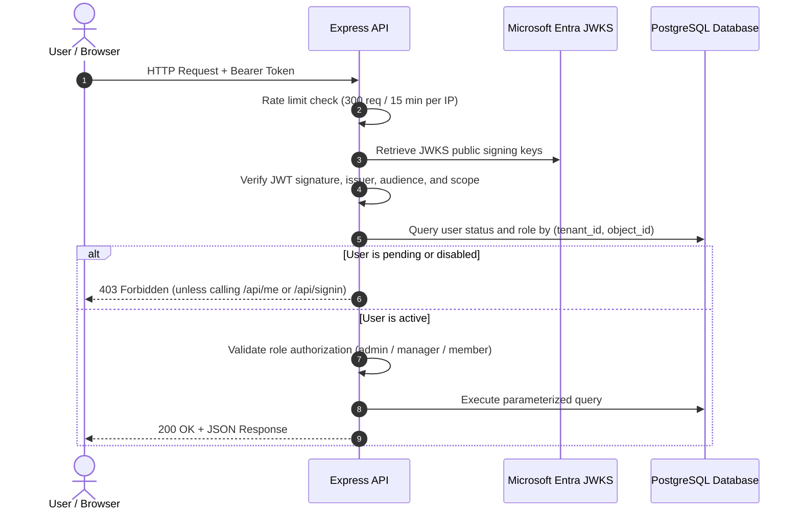

# SyncAI Server

The backend API for **SyncAI — Smart Work Planner**. Built with Node.js 22, Express 5, PostgreSQL (`pg`), JWT token verification via `jose`, and rate limiting with `express-rate-limit`. Unit and security tests use Node's built-in test runner.

---

## Getting Started

### Prerequisites

- **Node.js 22 or later**
- Accessible PostgreSQL database (Railway, cloud, or local PostgreSQL instance)

### Installation & Execution

```bash
cd server
npm install
cp .env.example .env
# Edit .env with your PostgreSQL and Azure App Registration credentials
npm run dev
```

The API starts at <http://localhost:3000/api>. On startup, database migrations run automatically:
- Creates required tables (`users`, `teams`, `team_memberships`, `activity`) if they do not exist.
- Applies unique indexes and constraints.
- Purges audit activity records older than the configured retention threshold (runs daily thereafter).

### Scripts

| Script | Description |
| --- | --- |
| `npm run dev` | Runs the API with Node `--watch` auto-reloading on code changes. |
| `npm start` | Starts the server once for production. |
| `npm test` | Runs the automated test suite (21 unit and security tests, no live database needed). |

---

## Configuration & Environment Variables

Copy [`.env.example`](.env.example) to `.env` (git-ignored) and configure:

| Variable | Required | Description |
| --- | --- | --- |
| `DATABASE_URL` | Yes | PostgreSQL connection string. When connecting from a local development machine to a hosted Railway instance, use `DATABASE_PUBLIC_URL` (requires **Public Networking** enabled in Railway). When running inside Railway or a cloud container, use the internal private connection string. |
| `ENTRA_CLIENT_ID` | Yes | Azure Application (client) ID for SyncAI. Matches `VITE_ENTRA_CLIENT_ID` in `client/.env`. |
| `ADMIN_EMAILS` | No | Comma-separated list of bootstrap administrator email addresses. Used solely when the database contains zero approved administrators: the first listed email to authenticate is provisioned as an active `admin`. |
| `ALLOWED_TENANT_IDS` | No | Comma-separated list of permitted Microsoft Entra tenant IDs. If omitted or empty, any Microsoft account can authenticate, but accounts are initialized in a `pending` state awaiting admin approval. |
| `ACTIVITY_RETENTION_DAYS` | No | Retention period for audit logs. Defaults to `365` (12 months). |
| `PORT` | No | Server listening port. Defaults to `3000`. |

> **Security Notice:** Never commit `.env` files or share database connection strings. We strongly recommend maintaining isolated database instances for local development, testing, and production environments.

---

## Authentication & Authorization Model



### 1. Token Verification (`src/auth.js`)
- Every protected endpoint requires an `Authorization: Bearer <token>` header.
- The server validates the token against Microsoft's public key sets (`jose.createRemoteJWKSet`).
- Verifies:
  - Token signature and expiration.
  - Issuer matches `https://login.microsoftonline.com/{tenantid}/v2.0`.
  - Audience matches `api://<ENTRA_CLIENT_ID>`.
  - Scope claim includes `access_as_user`.
  - Tenant ID matches `ALLOWED_TENANT_IDS` if configured.

### 2. User Lifecycle & Approval
- Users are indexed by immutable Microsoft Entra claims (`tenantId` and `objectId`), not mutable email addresses.
- New users start with `status: 'pending'` and `role: 'member'`.
- Pending and disabled accounts can only call `/api/me` and `/api/signin` to retrieve their current approval status.
- Only active administrators can approve users or modify roles.

---

## API Endpoints

### Public & Identity Routes

| Method | Endpoint | Authorization | Description |
| --- | --- | --- | --- |
| `GET` | `/api/health` | Public | Returns database connectivity status `{ ok: true, db: true }`. |
| `GET` | `/api/me` | Authenticated | Returns caller profile (`role`, `status`, `lastActiveAt`, and assigned `teams`). |
| `POST` | `/api/signin` | Authenticated | Called after login; records audit log event `signed_in` and returns user profile. |
| `POST` | `/api/signout` | Authenticated | Records explicit sign-out event `signed_out` (HTTP 204). |

### Administrator Governance Routes (`admin` role required)

| Method | Endpoint | Authorization | Description |
| --- | --- | --- | --- |
| `GET` | `/api/users` | Active Admin | Lists all registered users with roles, approval statuses, and activity timestamps. |
| `PATCH` | `/api/users/:id` | Active Admin | Modifies user `role` (`admin`, `manager`, `member`) or `status` (`active`, `pending`, `disabled`). Prevents admins from altering their own permissions. |
| `GET` | `/api/teams` | Active Admin | Lists all teams with their assigned managers and team members. |
| `POST` | `/api/teams` | Active Admin | Creates a new team (unique name, 1–80 characters). |
| `PATCH` | `/api/teams/:id` | Active Admin | Renames an existing team. |
| `DELETE` | `/api/teams/:id` | Active Admin | Deletes a team. Enforces that only empty teams can be deleted. |
| `POST` | `/api/teams/:id/members` | Active Admin | Adds a user to a team (`userId`, `kind`: `manager` or `member`). Validates role eligibility. |
| `DELETE` | `/api/teams/:id/members/:userId` | Active Admin | Removes a user from a team. |
| `GET` | `/api/activity` | Active Admin | Queries the append-only audit trail. Supports filtering by `person`, `action`, `limit`, and pagination `before`. |

### Manager Routes (`manager` role required)

| Method | Endpoint | Authorization | Description |
| --- | --- | --- | --- |
| `GET` | `/api/my-teams` | Active Manager | Returns only the teams managed by the caller, with member names, emails, and activity states. |

*(Note: Task scheduling, calendar time-blocking, and ripple intelligence endpoints are currently implemented in the prototype and are planned for migration to the Express API in the upcoming development phase.)*

---

## Team Domain Rules (`src/teams.js`)

SyncAI enforces strict business rules for team management:
1. **Role Alignment:** Only users with the `manager` role can manage teams; only `member` users can join as team members. Administrators cannot join teams, ensuring separation of duties.
2. **Member Allocation:** Each team member belongs to at most **one** operational team (enforced by a partial unique index in PostgreSQL). Managers may oversee multiple teams.
3. **Automatic Cleanup:** Changing a user's role automatically removes invalid team memberships within the same database transaction and generates an audit record.
4. **Disabled Account Protection:** Disabled accounts cannot be added to teams.

---

## Activity Audit Trail & PDPA Safeguards

The activity log provides an append-only, tamper-evident audit record of security and administrative actions:

| Action Code | Description |
| --- | --- |
| `signed_up` | Initial user sign-in and provisioning. |
| `signed_in` | Subsequent Microsoft authentication. |
| `opened` | Daily application access while session remains active (recorded at most once per day). |
| `signed_out` | Explicit user sign-out. |
| `approved` / `declined` | Administrator approves or declines a pending user account. |
| `role_changed` | User role promoted or demoted (`admin`, `manager`, `member`). |
| `status_changed` | User access status modified (`active`, `pending`, `disabled`). |
| `team_created`, `team_renamed`, `team_deleted` | Team administrative lifecycle operations. |
| `team_member_added`, `team_member_removed` | User assigned to or unassigned from an operational team. |

### Privacy Controls (PDPA)
- **No behavioural tracking:** Clicks, mouse tracking, screen durations, IP addresses, and user-agent strings are not recorded in the database.
- **Throttled timestamp updates:** `users.last_active_at` is updated at most once every 5 minutes to prevent unnecessary database write load.
- **Automated Retention:** Records older than `ACTIVITY_RETENTION_DAYS` (default: 365 days) are purged daily by an automated worker.
- **Append-only integrity:** No update or delete endpoints exist for the activity log.

---

## Security Controls (OWASP Top 10 Evaluation)

- **A01 Broken Access Control:** Every protected route verifies cryptographic JWT validity, database status, and role authorization. Admins cannot alter their own access.
- **A02 Cryptographic Failures:** Public key retrieval via HTTPS from Microsoft's published JWKS. Token validation via standard algorithms.
- **A03 Injection:** 100% of database interactions use parameterized SQL statements (`$1, $2`).
- **A04 Insecure Design:** New accounts default to pending status; append-only audit trail recorded in atomic transactions.
- **A05 Security Misconfiguration:** Headers stripped of `X-Powered-By`. Enforces `Cache-Control: no-store`, `X-Content-Type-Options: nosniff`, `X-Frame-Options: DENY`, `Referrer-Policy: no-referrer`, and deny-all CSP.
- **A07 Identification & Authentication Failures:** Completely delegates credentials to Microsoft Entra ID. No local password storage.
- **Rate Limiting:** IP-based sliding window limit of 300 requests per 15 minutes prevents brute-force probing. Request payloads restricted to 100 KB.

---

## Automated Tests

Run backend unit and security tests using Node's native test runner:

```bash
npm test
```

Verified test coverage (21 automated tests):
- Rejects missing, unsigned, or tampered tokens.
- Verifies initial admin bootstrapping and pending user provisioning.
- Enforces admin-only user management and prevents self-demotion.
- Enforces team membership constraints and manager view boundaries.
- Verifies rate limiting, security headers, and input parameter sanitization.
- Validates transactional audit record generation and retention filtering.
